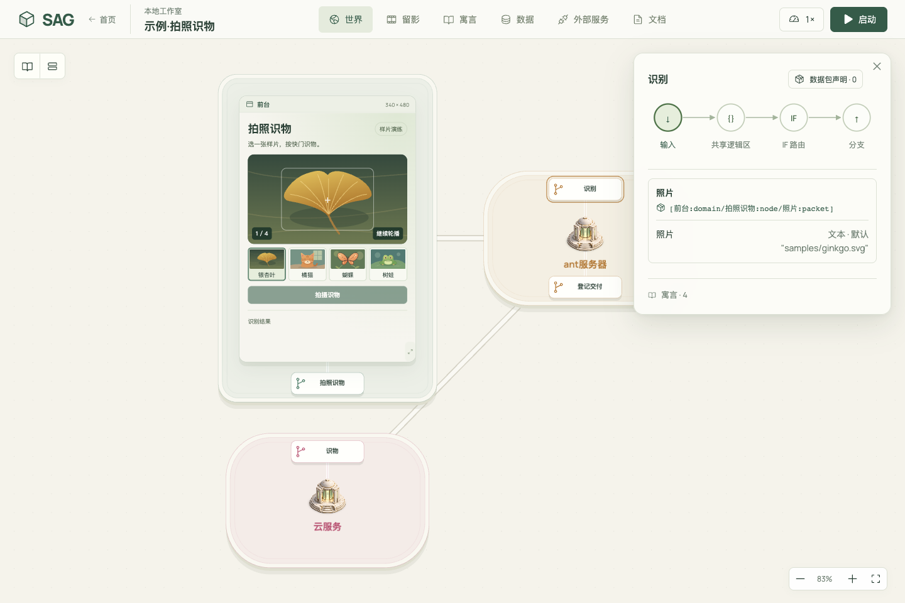

# SAG · Spec as Game

把业务规则写成可以运行和回放的世界。



需要 Node.js 22.13+。

```sh
npm ci
npm run dev
```

打开 [本地工作台](http://127.0.0.1:4880/) 试跑「拍照识物」，或添加 SAG 目录之外的世界。用 `world.yaml` 定义规则，用 `initial.sqlite` 提供初始数据。可选的前台、服务脚本和迁移文档也放在世界目录中。

[说明书](docs/manual.md) · [示例 YAML](examples/photo-recognition/world.yaml)
